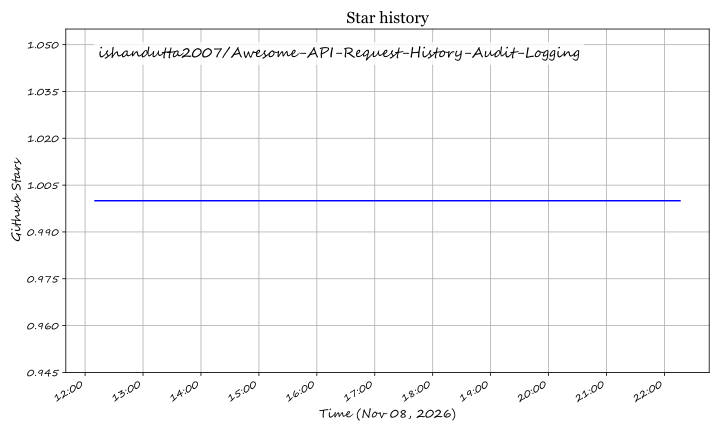

# ⚡ Awesome API Request History & Audit Logging 🛡️

**A curated list of awesome API request history trackers, audit trail platforms, log management systems, and high-throughput telemetry frameworks.**

  
  
  
  
  
  
  

  <b>Enterprise Observability • Distributed Tracing • Compliance Trails • OpenTelemetry • Hot/Cold Log Tiering</b>

---

## 📑 Table of Contents
- [📖 Sector Overview &amp; Market Dynamics](#-sector-overview--market-dynamics)
- [☁️ SaaS Products](#️-saas-products)
- [🔓 Open-Source &amp; Self-Hosted Solutions](#-open-source--self-hosted-solutions)
- [🌟 Star History](#-star-history)
- [🤝 Contributing](#-contributing)
- [💖 Support](#-support)
- [📄 License](#-license)

---

## 📖 Sector Overview & Market Dynamics

The API request history, log management, and audit logging sector is currently valued at approximately **$3.3B to $4.1B** (within the broader **$18B+** cloud observability, SIEM, and data intelligence market) and is projected to expand to **$6.5B to $10B+** at an estimated CAGR of 12–15%. 

The market is **moderately concentrated at the enterprise infrastructure layer**—dominated by mega-cap cloud providers (AWS) and unified observability giants (Datadog, Splunk/Cisco)—yet **fragmented at the application and developer tooling layer**, where modern entrants (Better Stack, Coralogix) compete aggressively on consumption economics, hot/cold decoupled storage, and developer experience.

---

## ☁️ SaaS Products

The table below lists leading commercial SaaS platforms providing API request logging, audit tracking, and centralized log management. The table is sorted in descending order by company size (valuation / market capitalization / annual revenue).

| Product | 🏢 Company Size (Valuation / Revenue) | 💳 Pricing (Starting Tier) | 🎁 Free Tier / Free Trial Limits | 🚀 Key Capabilities |
|---|---|---|---|---|
| **AWS CloudTrail** | Parent Market Cap: **~$2.1T+** / AWS Annual Revenue: **~$105B+** | **$0.10 per 100,000 data events**; additional management event copies at **$2.00 per 100,000 events** | **Free forever plan**: View/filter past 90 days of management events free in Event History; first copy of ongoing management events delivered to S3 is free. CloudTrail Lake offers a 30-day free trial (up to 5 GB ingestion & 5 GB scan). | Comprehensive API audit logging across all AWS services and infrastructure; immutable event history. |
| **Datadog** | Market Cap: **~$65B** / Annual Revenue: **~$4.5B** | **$0.10/GB ingested** + **$1.06 per 1 million events** indexed (3-day retention, annual commitment; or ~$1.27/M for 7-day) | **14-day free trial** with full access to log ingestion, live tail, and indexing features (standard free tier covers infrastructure metrics only up to 5 hosts, excluding full log search). | Full-stack observability, unified API log ingestion, trace correlation, real-time alerting, and automated anomaly detection. |
| **Splunk Cloud Platform** | Valuation: **$28B** (Acquired by Cisco) / Annual Revenue: **~$3.8B–$4B** | **~$1,800 to $2,500 per GB/day annually** (approx. starting list ingest price; workload pricing also available based on SVC units) | **14-day free trial** with a limit of **5 GB per day** ingestion (self-hosted Splunk Free offers perpetual 500 MB/day indexing). | Enterprise-scale log aggregation, SIEM security compliance, sophisticated SPL search, and high-throughput audit indexing. |
| **Papertrail** | Valuation: **$4.4B** (SolarWinds acquisition by Turn/River) / SolarWinds Revenue: **~$797M** | Starts at **$7.00/month** for 1 GB/month (includes 1 week search and 1 year archive) | **Free forever plan**: **50 MB per month** transfer, **48 hours** search retention, **7 days** archive retention, unlimited systems and users. | Lightweight, instant-setup cloud log management with live-tail streaming search and fast regex querying. |
| **Sumo Logic** | Valuation: **$1.7B** (Acquired by Francisco Partners) / Revenue: **~$242M** | **Flex Pricing**: **$0/GB ingest**, pay-per-TB scanned estimated at **$3.14/TB scanned** (entry packages start around ~$297/month) | **30-day free trial** with full platform capabilities; perpetual free tier provides **500 MB/day** ingestion, **7-day** retention, and up to **3 users**. | Cloud-native analytics, automated threat detection, audit compliance dashboards, and Flex scan-based pricing. |
| **Coralogix** | Valuation: **$1.6B** (Series F) / Annual Revenue: **~$90M+** | **$1.50 per unit** (Logs: **$0.42 to $1.15 per GB** based on priority tier; 0.12–0.75 units/GB) | **14-day free trial** with full access to all features, capped at **8 Coralogix Units (CXUs)** (~$12 worth of data pipeline processing). | Streama real-time stream analysis without indexing, long-term archive querying, and automated cost-optimization pipelines. |
| **Better Stack** | Valuation: **~$40M–$60M** (Series A) / Annual Revenue: **~$3.5M–$4M** | **$25/month** billed annually ($30/month monthly) for the Nano plan (40 GB storage, $0.10/GB extra ingestion) | **Free forever plan**: **3 GB logs/month** (3-day retention), **3 GB traces/month**, **30 GB metrics/month**, up to **10 monitors**, Slack/email alerts. | Modern ClickHouse-powered developer-friendly log management, unified telemetry, uptime monitoring, and built-in incident management. |

---

## 🔓 Open-Source & Self-Hosted Solutions

For engineering teams prioritizing data sovereignty, local compliance, or private cloud environments, these leading open-source projects power high-throughput API logging, distributed tracing, and immutable audit trails.

The list is sorted in descending order by GitHub stargazers count:

| Project & Repo Link | ⭐ GitHub_Stars | 📜 License | 💡 Architecture & Use Case |
|---|---|---|---|
| [**SigNoz**](https://github.com/SigNoz/signoz)  | ~32,500+ | Apache 2.0 / MIT | Full-stack OpenTelemetry-native APM and observability suite powered by ClickHouse columnar storage for blazing-fast API log aggregation and trace correlation. |
| [**Grafana Loki**](https://github.com/grafana/loki)  | ~29,100+ | AGPL 3.0 | Horizontally scalable, multi-tenant log aggregation engine inspired by Prometheus; indexes only metadata labels to drastically reduce storage footprint. |
| [**Apache SkyWalking**](https://github.com/apache/skywalking)  | ~25,000+ | Apache 2.0 | Application performance monitor (APM) and distributed system telemetry designed for microservices, cloud native, and large-scale containerized API architectures. |
| [**Jaeger**](https://github.com/jaegertracing/jaeger)  | ~23,400+ | Apache 2.0 | CNCF Graduated distributed tracing platform for monitoring microservices transactions, inspecting API call chains, and root-cause debugging. |
| [**Vector**](https://github.com/vectordotdev/vector)  | ~22,800+ | MPL 2.0 | High-performance Rust-based end-to-end telemetry collector, enricher, and router for logs, metrics, and audit event streams. |
| [**Elastic Logstash**](https://github.com/elastic/logstash)  | ~15,000+ | Apache 2.0 / Elastic | Proven server-side data processing pipeline that ingests data from dozens of simultaneous sources, parses and transforms events, and ships them to Elasticsearch or OpenSearch. |
| [**Fluentd**](https://github.com/fluent/fluentd)  | ~13,600+ | Apache 2.0 | CNCF Graduated unified logging layer allowing data collection and consumption unification for better system understanding and long-term archiving. |
| [**Fluent Bit**](https://github.com/fluent/fluent-bit)  | ~8,200+ | Apache 2.0 | Fast, lightweight log, metric, and trace processor and forwarder engineered in C for cloud, embedded, and Kubernetes edge environments. |
| [**Graylog**](https://github.com/Graylog2/graylog2-server)  | ~8,200+ | GPL / SSPL | Enterprise-grade centralized log management and SIEM platform offering comprehensive search, dashboarding, and compliance audit trail alerting. |
| [**OpenTelemetry Collector**](https://github.com/open-telemetry/opentelemetry-collector)  | ~7,700+ | Apache 2.0 | Vendor-agnostic proxy implementation that can receive, process, and export telemetry data (metrics, logs, traces) to multiple observability backends. |
| [**go-audit**](https://github.com/slackhq/go-audit)  | ~1,700+ | MIT | Alternative to auditd developed by Slack that speaks the Linux Audit Netlink protocol, converting raw kernel and system call events into structured JSON. |

---

## 🌟 Star History

---

## 🤝 Contributing

Contributions, issues, and feature requests are very welcome!  
Feel free to check the [issues page](https://github.com/ishandutta2007/Awesome-API-Request-History-Audit-Logging/issues) if you want to suggest a new tool or update existing benchmarks.

1. 🍴 Fork the project (`https://github.com/ishandutta2007/Awesome-API-Request-History-Audit-Logging/fork`)
2. 🚀 Create your feature branch (`git checkout -b feature/NewAwesomeTool`)
3. 💾 Commit your changes (`git commit -m 'feat: Add NewAwesomeTool'`)
4. 📤 Push to the branch (`git push origin feature/NewAwesomeTool`)
5. 🔀 Open a Pull Request

---

## 💖 Support

Thank you so much for visiting this repository! If you found this curated list helpful:
- ⭐ **Star** this repository on GitHub to show support.
- 🍴 **Fork** and share it with fellow software engineers, DevOps leads, and security professionals.
- ☕ If you'd like to support ongoing curation and maintenance, you can sponsor or buy a coffee via the [GitHub Sponsor Dashboard](https://github.com/sponsors/ishandutta2007).

---

## 📄 License

This repository is distributed under the MIT License. See [LICENSE](LICENSE) for more information.

## ⭐ Star History

<a href="https://star-history.com/#ishandutta2007/Awesome-API-Request-History-Audit-Logging&Timeline" align="center">
  <picture>
    <source media="(prefers-color-scheme: dark)" srcset="assets/ishandutta2007_Awesome-API-Request-History-Audit-Logging_growth.svg">
    
  </picture>
</a>
